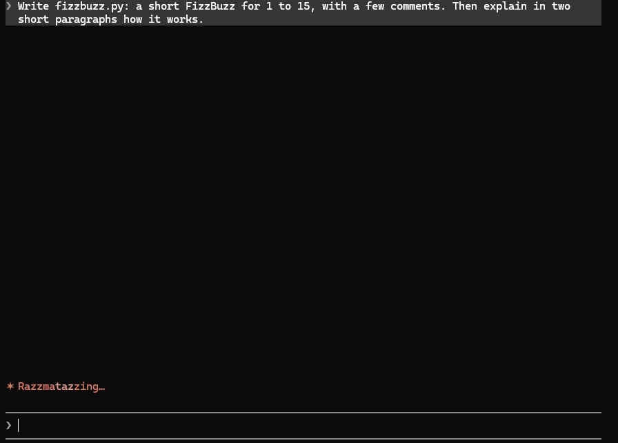

# live-typing

A Claude Code mod that shows Claude's work live above the prompt: the reply, its thinking, the code it writes and the commands it runs type out letter by letter as they stream.



## Install

At the Claude Code prompt:

```
/plugin install live-typing --marketplace Dangusi/claude-live-typing
```

Answer `y` to add the marketplace, then pick a scope. Or from a shell:

```
claude plugin install live-typing --marketplace Dangusi/claude-live-typing
```

Then run `/reload-plugins` or start a new session. Typing is on from the start.

## Use

`/live-typing` opens a small picker: arrows to move, Enter to choose, Esc to close.

- Typing: On, Demo (the next reply only, slow enough to follow, then back), Off.
- Agents in the main view: Full (a helper agent's live typing under its name, while Claude is idle or waiting on it), Brief (just its name and what it is doing, when it starts and finishes), Off.

The same without the picker:

```
/live-typing on | off | demo
/live-typing agents full | brief | off
```

On/Off and the agents setting are remembered for new sessions; Demo is not. Agents start as Off. A helper agent's own view (opened from the tasks list) always shows its typing.

A reply types where it will stay. In the fullscreen layout (`"tui": "fullscreen"`) it types right in the transcript, under your prompt in a short chat and at the bottom in a long one, so the text never jumps when it is done; if you have scrolled up, the band above the prompt shows it meanwhile. On the classic screen the band types it and the transcript takes over from where the band left off. Code, commands and tools always type in the band.

Known limit: Claude Code gives a mod at most 500 transcript rows per conversation. In a very long fullscreen conversation, replies after that type in the band above the prompt instead.

## Bugs and ideas

Open an issue: https://github.com/Dangusi/claude-live-typing/issues

## License

MIT
